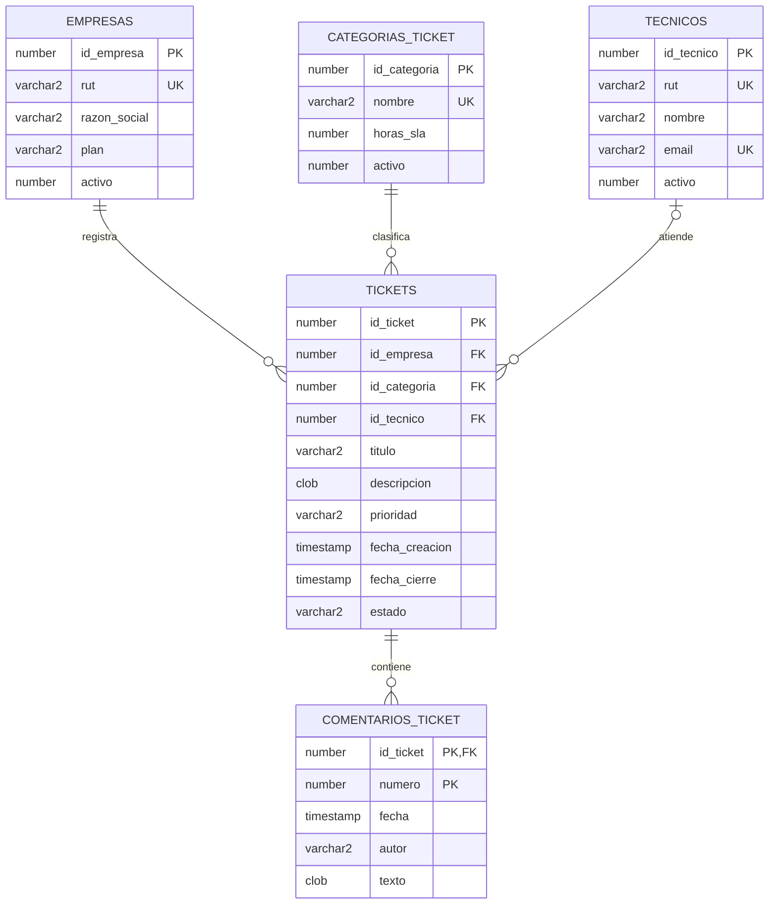

# Modelo de datos — SoporteYa

## Cardinalidades

- Una empresa puede registrar muchos tickets; cada ticket pertenece a una empresa.
- Una categoría puede clasificar muchos tickets; cada ticket tiene una categoría.
- Un técnico puede atender muchos tickets; un ticket puede estar todavía sin técnico mientras permanezca abierto.
- Un ticket puede contener muchos comentarios; cada comentario pertenece a un único ticket.

La clave de `comentarios_ticket` es compuesta por `id_ticket` y `numero`.

