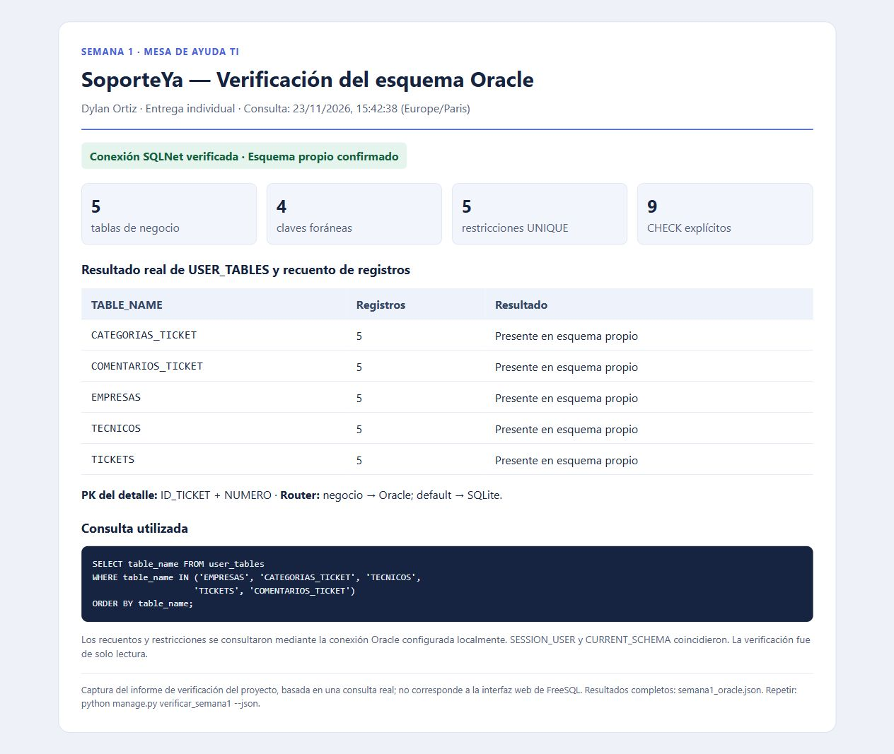

# Semana 1 — SoporteYa

Estudiante: Dylan Ortiz. Entrega individual. Problema desarrollado: Mesa de ayuda TI «SoporteYa», G12 en la pauta.

| Punto solicitado | Evidencia |
| --- | --- |
| Inscripción y reparto, Anexo A | [Anexo A preparado](anexo_a.md), con las cinco entidades asignadas a Dylan Ortiz. Número administrativo de grupo, sección e inscripción deben confirmarse con el docente; no se han inventado ni validado por software. |
| Modelo ER y diccionario | [Modelo ER](modelo_datos.md) y [diccionario](diccionario_datos.md), alineados con las cinco tablas y la clave compuesta del detalle. |
| Scripts ejecutados en el esquema personal | Scripts `backEnd/sql/01_crear_tablas.sql` y `02_datos_ejemplo.sql`; consulta real de las cinco tablas propias con cinco registros en cada una. [Informe y captura](#evidencia-oracle). |
| Repositorio y configuración de ejemplo | `.gitignore`, `.env.example` y README versionados. `.env`, las bases SQLite y los entornos locales están excluidos. |
| Settings, dos bases, router y conexión | `default` usa SQLite para Django; `negocio` usa Oracle; el router envía correctamente los modelos de cada aplicación. La conexión fue comprobada por lectura de metadatos y datos. |

## Evidencia Oracle

Consulta del 23 de noviembre de 2026 mediante la conexión SQLNet del esquema personal: cinco tablas, cinco PK, cuatro FK, cinco restricciones UNIQUE y nueve CHECK explícitos. La PK de `COMENTARIOS_TICKET` contiene `ID_TICKET` y `NUMERO`.



Esta imagen es una captura del informe de verificación del proyecto basado en consultas reales. No corresponde a la interfaz web de FreeSQL ni certifica la inscripción del estudiante.

- [Resultados consultados en JSON](evidencias/semana1_oracle.json).
- [Informe HTML que se capturó](evidencias/semana1_oracle.html).

## Repetir la comprobación

```powershell
Set-Location "C:\Users\Dylan\Desktop\SoporteYa\backEnd"
.\.venv\Scripts\python.exe manage.py verificar_semana1
.\.venv\Scripts\python.exe manage.py verificar_semana1 --json
```

El comando es de solo lectura. No se necesita repetir los scripts de creación para verificar las tablas; el primer script elimina las tablas existentes antes de recrearlas.

La parte técnica y los documentos de reparto están preparados para la entrega. La validación de inscripción, sección y número de grupo corresponde al docente.
